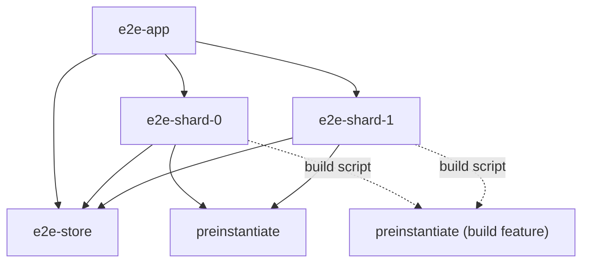

# End-to-end example

This directory shows preinstantiate used the way a real project would use it,
with a build script that reads another crate's source.

This directory has:

1. [**`e2e-store`**](e2e-store): The upstream crate. It defines `DataStore`,
   whose public async methods are spread over a few modules. One method is
   generic, so preinstantiate skips it.
2. [**`e2e-shard-0`**](e2e-shard-0) and [**`e2e-shard-1`**](e2e-shard-1):
   The shard crates. Each one has a build script that reads `e2e-store`'s
   source, picks out the methods in the files assigned to its shard, and
   writes a `preinstantiate_async_fns` function that the crate `include!`s.
   The shared configuration is defined in
   [`preinstantiate_config.rs`](preinstantiate_config.rs) and is included
   by each build script.
3. [**`e2e-app`**](e2e-app): The downstream crate, which calls `DataStore`'s
   methods. It depends on both shard crates and names them with `use ... as
   _`, so that rustc loads them and share-generics can use the instances they
   compiled.

Here's the dependency graph:

`e2e-app`'s test runs one of its async functions, which calls methods from
both shards.

Each shard crate's tests check two things:

- The report from the build script matches `tests/output/report.txt`, so you
  can see which methods each shard picked up and which ones it skipped.
- `preinstantiate_async_fns` compiles and runs. If the build script wrote a
  path that doesn't resolve, or a method whose arity doesn't match its helper,
  the shard crate would fail to build.

These tests don't show that downstream crates actually reuse the instances
through share-generics. To check that, you'd need to inspect the symbols in
the compiled artifacts.
